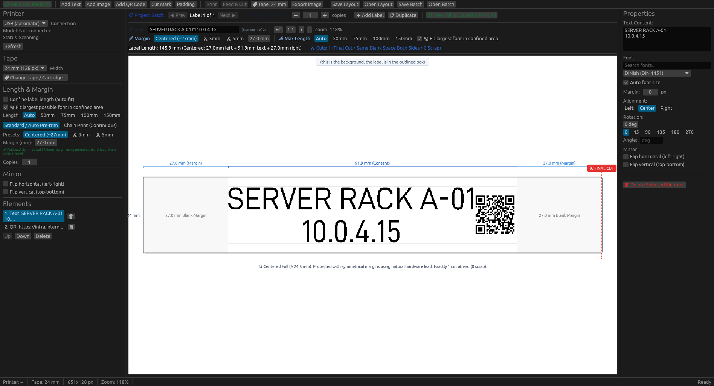
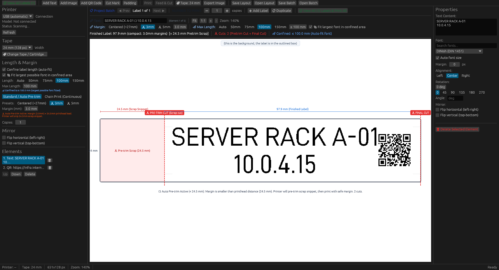
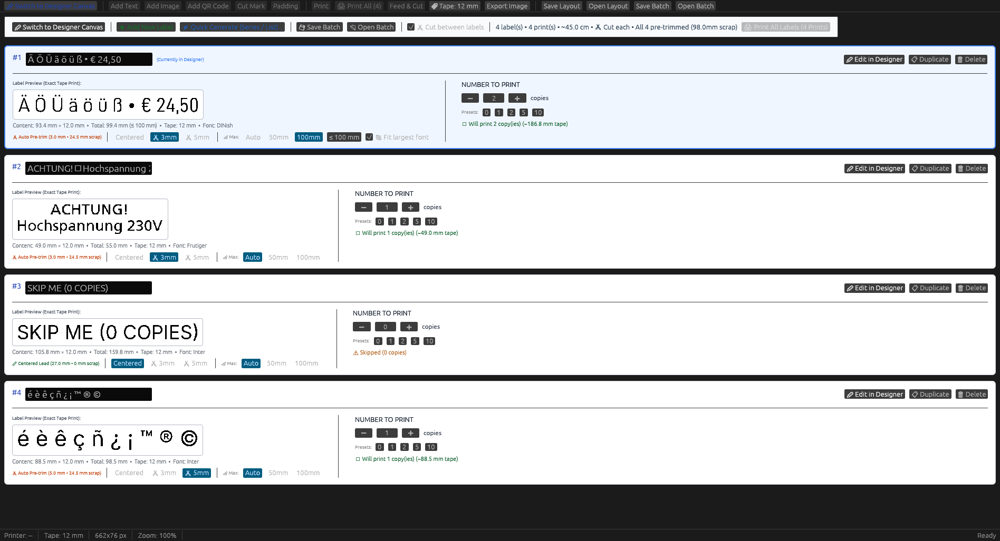
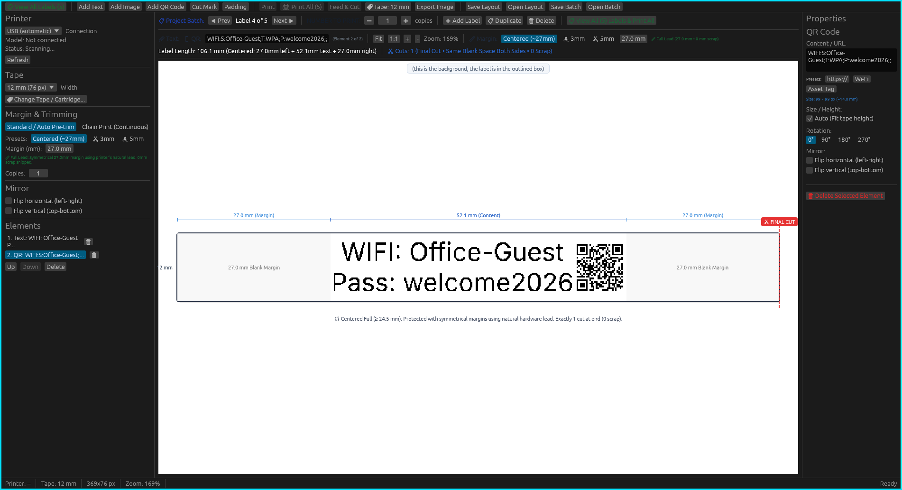
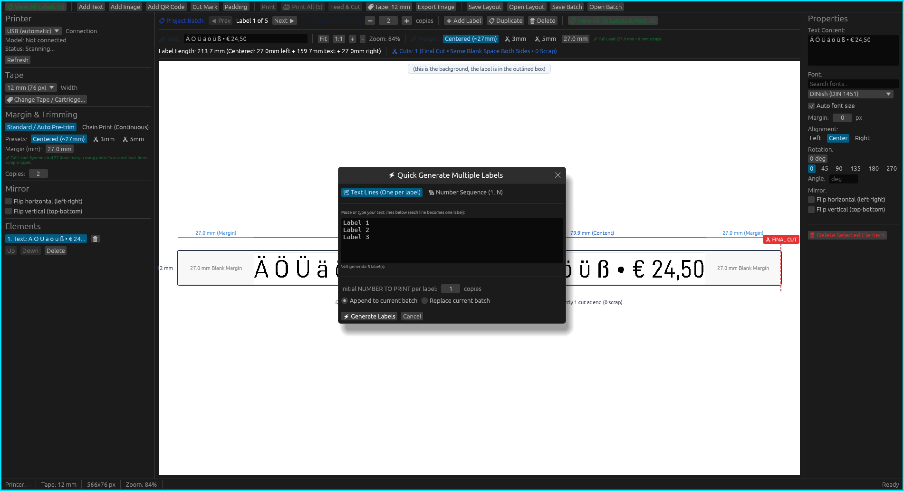

# ptouch-rs-notstupid

> [!IMPORTANT]
> **Hardware & Platform Target Notice:**
> Everything changed, patched, and developed in this repository was **tested exclusively on the Brother P-touch PT-D600 under Linux**. We do not test or guarantee behavior on other printer models or non-Linux operating systems.

Fast, zero-bloat Rust **GUI & CLI** for Brother P-Touch USB label printers (originally forked from [vowstar/ptouch-rs](https://github.com/vowstar/ptouch-rs)).

**Quick Links:** [📸 Feature Showcase](#-visual-feature-showcase) • [✨ Feature Overview](#-feature-overview) • [🚀 Quick Start (Linux)](#-quick-start-linux) • [🖥 CLI Usage](#-cli-usage) • [📖 PT-D600 Linux Guide](docs/pt-d600-linux.md)



<p align="center">
  <em>ptouch-gui Designer Canvas: true-to-scale tape preview, millimeter rulers, cut line indicators, inline text/QR editing, and one-click margin & length controls.</em>
</p>

---

## 📸 Visual Feature Showcase

### 1. 📐 Label Length Confinement & "Fit Largest Possible Font"



- **What it is:** Confines the total finished cut label to a target length (e.g. `≤ 100 mm`) and automatically scales text to fit.
- **🔠 Fit Largest Possible Font in Confined Area (Default):** Measures the **exact drawn pixel ink bounding box** (`min_x..max_x, min_y..max_y`) and binary-searches the largest possible font size that fills the full tape height and confined width. For long single-line text, it automatically tests balanced 2-line and 3-line word splits and picks whichever layout gives the largest letters.
- **Smart Compact Margins:** Automatically switches to a compact `3.0 mm` pre-trim margin when maximizing font inside a confined length (giving **`94 mm` of printable space** on a `100 mm` label instead of wasting `54 mm` on `27 mm` leader margins). Shorter labels keep their natural length without blank padding.
- **How to use:** Click `50mm | 75mm | 100mm | 150mm` (or drag `≤ XX mm`) in the top canvas bar or left sidebar, or pass `-L 100` (`--max-length 100`) in the CLI.

---

### 2. 📋 Multi-Label Batch Overview & Continuous Printing



- **What it is:** A full-screen batch dashboard showing every label in your project side-by-side with live 1:1 previews and a prominent **NUMBER TO PRINT** counter beside each card.
- **Per-Label Controls:** Edit text or QR content inline, toggle **Centered (`0 mm` scrap)** vs. **Auto Pre-trim (`3 mm` / `5 mm` margin)**, and set per-label **Max Length (`Auto | 50mm | 100mm`)** + **Fit Largest Font** without leaving the batch screen.
- **Zero-Waste & Mixed Batches:** Prints multi-copy and multi-label jobs in a continuous chain or automatically combines centered and pre-trimmed labels in a single batch run.
- **How to use:** Click **📋 View All Labels & Print All** in the toolbar, or use the `←` / `→` arrow keys in the Designer to flip between labels.

---

### 3. 📱 Crisp 1-Bit Native QR Code Engine



- **What it is:** A pure-Rust 1-bit QR code renderer built specifically for 180/360 DPI thermal printheads.
- **Why it scans reliably:** Uses integer pixel module scaling ($M \ge 1$ px/module) and standard 4-module quiet zones—zero grayscale anti-aliasing or subpixel blur.
- **How to use:** Click **Add QR Code** in the toolbar (or pass `-q "https://..."` in the CLI). Includes 1-click presets for **URLs**, **Wi-Fi credentials** (`WIFI:S:...`), and **Asset Tags**, plus `0°–270°` rotation.

---

### 4. ⚡ Quick Batch Generator (Series & Lists)

<details open>
<summary><strong>Click to view Quick Batch Generator screenshot</strong></summary>
<br>



- **What it is:** Generates dozens of sequential labels (e.g. `RACK-01` through `RACK-24` with configurable zero-padding) or converts a pasted multi-line text list into individual batch labels in one click.
- **How to use:** In **Batch Overview**, click **⚡ Quick Generate (Series / List)...**.

</details>

---

### 5. ⚙️ Tape Cartridge Setup & Remaining Length Tracker

<details>
<summary><strong>Click to view Tape Setup & Cartridge Modal screenshot</strong></summary>
<br>


- **What it is:** Startup and on-demand tape selector (`3.5 mm` to `36 mm`) with optional cartridge length tracking (`8 m` standard / `4 m` starter tape). Warns you before starting a batch if the required tape exceeds what remains in the cartridge.

</details>

---

## ✨ Feature Overview

| Category | Capabilities |
| :--- | :--- |
| **📐 Sizing & Margins** | **Confine Label Length** (`Auto`, `50mm`, `75mm`, `100mm`, `150mm`, custom `mm`), **Fit Largest Possible Font** (tight ink bbox + balanced multi-line wrap), **Centered Lead** (`~27 mm`, `0 mm` scrap), **Auto Pre-Trim** (`3 mm` / `5 mm` compact margins), and **Continuous Chain Print** (`0 mm` gap). |
| **🔤 Bundled Fonts** | Embedded **Inter** (clean modern default), **DIN 1451 / DINish** (German industrial/engineering signage standard), and **Frutiger** (high-legibility signage), plus full system font search. |
| **🧩 Elements & Layout** | Multi-element composition (**Text**, **QR Code**, **Image** `PNG/JPG/SVG/BMP/WebP`, **Cut Mark**, **Padding**), per-element or whole-label horizontal/vertical mirroring, free-angle rotation, and self-contained `.ptl` / `.ptb` project files. |
| **🛡 Hardware Safety** | Print actions lock until a printer is detected online; live background USB status polling; immediate **⏹ Cancel Print / Cancel Batch** button; USB packet fragmentation & error recovery fixes for the PT-D600. |
| **🤖 CLI & Automation** | Headless PNG/BMP/JPEG export without a printer, `-L <MM>` length confinement, `{{variable}}` template placeholders, and automated CSV batch printing (`--csv`). |

---

## 🚀 Quick Start (Linux)

### 1. Install Dependencies & Build

```sh
# Debian / Ubuntu
sudo apt install build-essential pkg-config libusb-1.0-0-dev libudev-dev

# Arch Linux / CachyOS
sudo pacman -S --needed base-devel git libusb systemd-libs

# Build release binaries
cargo build --release --workspace
```

Binaries are placed in `target/release/ptouch-gui` (GUI) and `target/release/ptouch` (CLI).

### 2. Configure USB Permissions (Linux `udev`)

```sh
sudo cp data/udev/20-usb-ptouch-permissions.rules /etc/udev/rules.d/
sudo udevadm control --reload-rules
sudo udevadm trigger
```

*(See the [PT-D600 Linux Guide](docs/pt-d600-linux.md) if the kernel `usblp` module claims the printer or for WSL 2 setup.)*

### 3. Run the GUI

```sh
./target/release/ptouch-gui
```

---

## 🖥 CLI Usage

```sh
# Print a simple text label
ptouch print "Hello World"

# Confine total finished label length to ≤ 100 mm (fits largest possible font in 100 mm)
ptouch print -L 100 "WARNING: HIGH VOLTAGE 230V AC - DO NOT TOUCH"

# Print combined text + crisp QR code
ptouch print "SERVER RACK A-01" -q "https://infra.internal/rack/A-01"

# Export a preview to PNG without a printer connected (76 px = 12mm tape, 128 px = 24mm tape)
ptouch print -L 100 "SERVER RACK A-01" -w 76 -o preview.png

# Print or export a saved GUI layout (.ptl)
ptouch print --layout examples/pt-d600-qr-asset.ptl
ptouch print --layout examples/pt-d600-qr-asset.ptl -o asset-preview.png

# Batch-print a template layout from a CSV file
ptouch print --layout badge.ptl --csv people.csv

# Query connected printer & loaded tape cartridge
ptouch info
```

### CLI Print Flags

| Short | Long | Description |
| :---: | :--- | :--- |
| | `TEXT...` | Text lines (up to 4 arguments) |
| `-L` | `--max-length <MM>` | Confine total finished label length to `≤ MM` millimeters (auto-fits largest font) |
| `-q` | `--qr <TEXT>` | Append a 1-bit QR code (URL, Wi-Fi string, or text) |
| `-i` | `--image <PATH>` | Append an image (`PNG`, `JPEG`, `SVG`, `BMP`, `WebP`, `GIF`, `TIFF`) |
| `-l` | `--layout <FILE>` | Load a saved `.ptl` layout file |
| | `--set KEY=VAL` | Fill a `{{KEY}}` placeholder in a `--layout` file (repeatable) |
| | `--csv <FILE>` | Print one label per CSV row (`-` for `stdin`) |
| `-f` | `--font <NAME>` | Font family (default: `Inter`; bundled: `Inter`, `DINish`, `Frutiger`) |
| `-s` | `--size <PT>` | Explicit font size in points (auto-sized if omitted) |
| `-a` | `--align <ALIGN>` | Text alignment: `left`, `center`, `right` |
| `-m` | `--margin <PX>` | Vertical top/bottom text margin in pixels |
| `-c` | `--cut` | Append a dashed cut-mark separator |
| `-p` | `--pad <PX>` | Append blank horizontal padding in pixels |
| | `--flip-h` / `--flip-v` | Mirror the whole label horizontally or vertically |
| | `--precut` | Pre-trim the ~24.5 mm hardware leader scrap before printing |
| | `--chain` | Skip final feed/cut for continuous chained labels |
| | `--copies <N>` | Number of copies to print (intermediate copies chain with zero waste) |
| `-o` | `--output <FILE>` | Save rendered label to an image file instead of printing |
| `-w` | `--tape-width <PX>` | Printable tape height in pixels when exporting with `-o` (`76` for 12 mm, `128` for 24 mm) |

---

## 🛡 Hardware Safety & On-Board Memory FAQ

| Question | Answer |
| :--- | :--- |
| **Does direct USB printing wear out printer flash memory?** | **No.** Direct raster printing (`ESC i a 01h`) uses 100% volatile RAM with zero writes to flash memory. |
| **Why is there a ~24.5 mm blank leader on P-Touch printers?** | The physical cutter blade sits ~24.5 mm ahead of the thermal printhead, and TZe laminated tape only feeds forward. Use **Centered (~27mm)** to turn that leader into a symmetrical margin with `0 mm` scrap, or **✂ 3mm Pre-trim** to automatically snip the leader scrap for compact labels. |
| **What printers and tape widths are supported?** | Tested on **Brother PT-D600** (Linux USB). Protocol tables also include PT-P700, PT-P750W, PT-E500, PT-E550W, PT-H500, PT-D450, PT-D460BT, PT-D610BT, PT-P300BT (macOS Bluetooth), and others across `3.5 mm`, `6 mm`, `9 mm`, `12 mm`, `18 mm`, `24 mm`, and `36 mm` tapes. |

---

## 🗂 Repository Structure

```text
ptouch-rs-notstupid/
├── crates/
│   ├── ptouch-core/    # USB/Bluetooth transport, status protocol, device & tape tables
│   ├── ptouch-render/  # 1-bit bitmap, tight ink-bbox text engine, QR generator, layout model
│   ├── ptouch-cli/     # Command-line interface (`ptouch`)
│   └── ptouch-gui/     # Interactive desktop designer & batch manager (`ptouch-gui`)
├── data/               # Linux udev rules, desktop launcher, and application icons
├── docs/               # PT-D600 Linux guide (`pt-d600-linux.md`) and UI screenshots
└── examples/           # Sample single-label (`.ptl`) and batch (`.ptb`) layouts
```

---

## 📄 License

The printer protocol and device layer in `crates/ptouch-core/` and `crates/ptouch-render/src/raster.rs` are derived from [ptouch-print](https://git.familie-radermacher.ch/linux/ptouch-print.git) by Dominic Radermacher and contributors (**GPL-3.0-or-later**). Original rendering, CLI, and GUI code is dual/per-file licensed under **MIT** (see [LICENSE](LICENSE), [LICENSE-MIT](LICENSE-MIT), and [NOTICE](NOTICE)). Distributed binaries are **GPL-3.0-or-later**.
