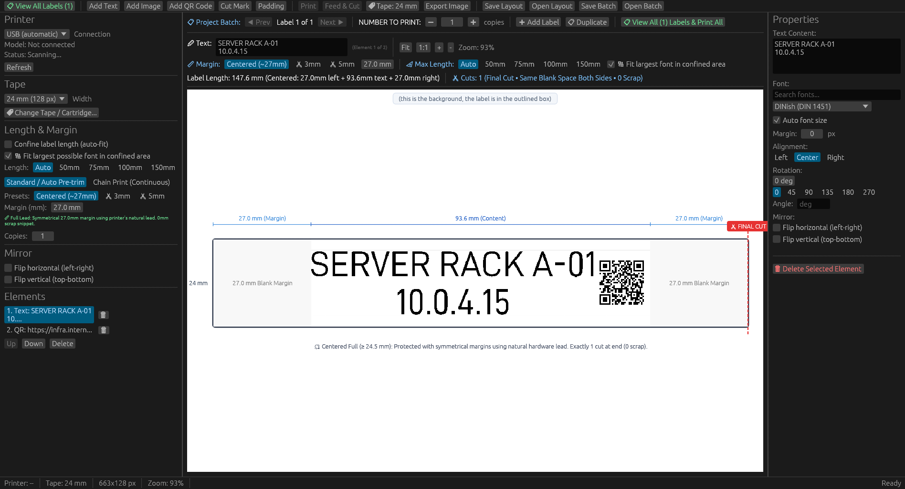
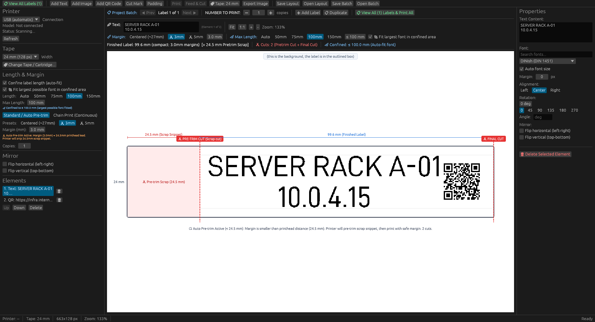
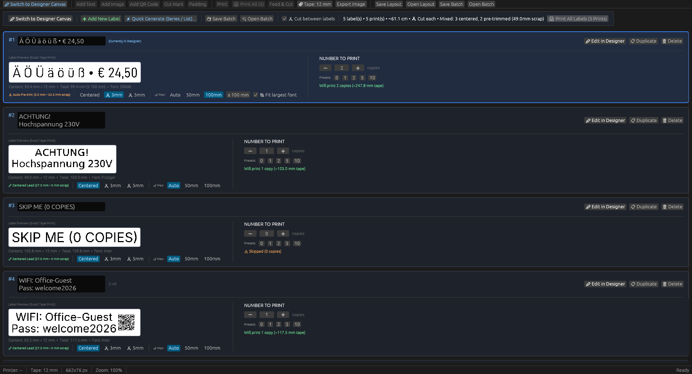
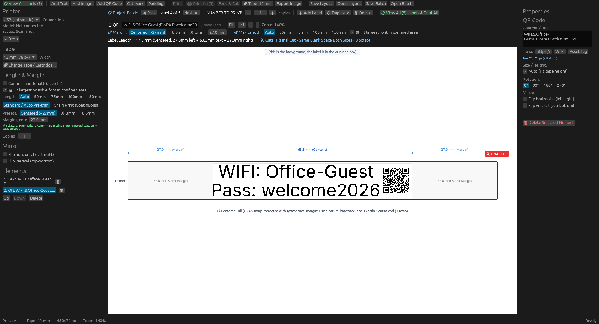
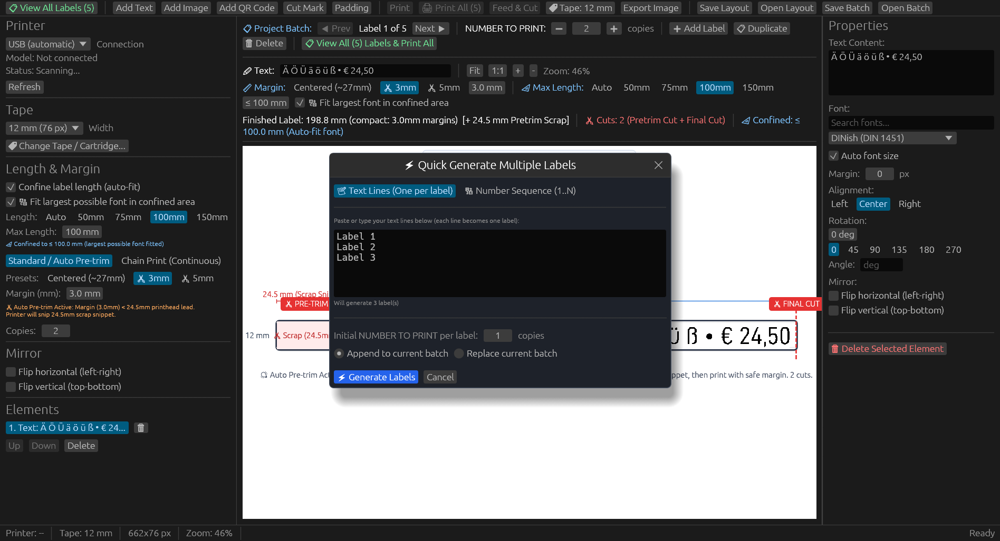
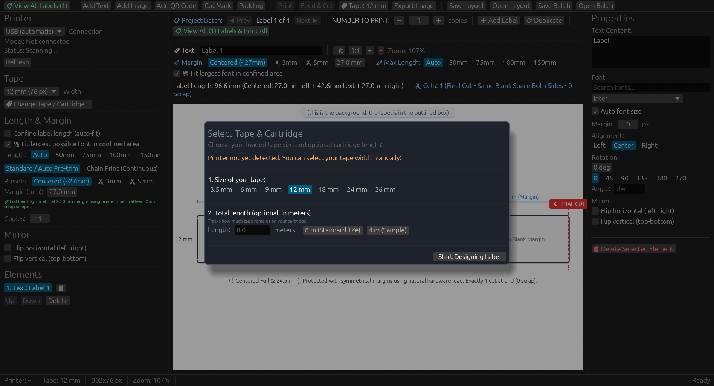

# ptouch-rs-notstupid

Desktop GUI (`ptouch-gui`) and CLI (`ptouch`) for Brother P-Touch USB label printers, written in Rust and forked from [vowstar/ptouch-rs](https://github.com/vowstar/ptouch-rs).

> [!NOTE]
> All changes in this fork are tested only on a **Brother PT-D600 running under Linux**. Other printer models and Windows/macOS builds come from upstream and are provided on a best-effort basis without hardware testing.



## Download

Prebuilt GUI and CLI binaries are available on the [GitHub Releases](https://github.com/wakuwakumiwaku/ptouch-rs-notstupid/releases/latest) page:

- **Linux (x86-64):** Debian/Ubuntu `.deb`, Fedora/RHEL `.rpm`, and standalone binaries (`ptouch`, `ptouch-gui`). Requires GLIBC 2.35+ (Ubuntu 22.04 or newer) and `libudev`.
- **Windows (x86-64, experimental):** `ptouch.exe` and `ptouch-gui.exe`.
- **macOS (Apple Silicon, experimental):** standalone binaries and `ptouch-gui-macos-arm64.app.zip`.

Every release ships with `SHA256SUMS` (`sha256sum --ignore-missing -c SHA256SUMS` on Linux, or `Get-FileHash <file> -Algorithm SHA256` on Windows). Standalone Linux/macOS binaries need `chmod +x <file>` before launching. Binaries and packages are unsigned, so OS security prompts may appear.

### Linux USB permissions

The `.deb` and `.rpm` packages install the udev rule automatically. If you use standalone binaries or build from source, install the rule so you can print without `sudo`:

```sh
sudo cp data/udev/20-usb-ptouch-permissions.rules /etc/udev/rules.d/
sudo udevadm control --reload-rules
sudo udevadm trigger
```

Unplug and reconnect the printer afterward. For `usblp` kernel driver conflicts, headless sessions, or WSL 2 USB passthrough, see [docs/pt-d600-linux.md](docs/pt-d600-linux.md).

## Building from source

```sh
# Debian / Ubuntu
sudo apt install build-essential pkg-config libusb-1.0-0-dev libudev-dev

# Arch Linux / CachyOS
sudo pacman -S --needed base-devel git libusb systemd-libs

cargo build --release --workspace --locked
```

Binaries are written to `target/release/ptouch-gui` and `target/release/ptouch`.

## GUI tour

### Designer canvas & tape preview

The main view shows the label at scale with millimeter dimensions, left/right margins, and cut indicators. Double-click the label to edit text inline, pick from bundled fonts (**Inter**, **DINish / DIN 1451**, **Frutiger**) or any installed system font, and combine text, QR codes, images (`PNG`, `JPEG`, `SVG`, `BMP`, `WebP`, `GIF`, `TIFF`), padding, and cut marks. Designs save to self-contained `.ptl` files with embedded images.

### Length confinement & auto-fit font



Set a maximum finished label length (`50mm`, `75mm`, `100mm`, `150mm`, or a custom value in mm) and the renderer sizes the text to stay within that cut length. With **Fit largest font in confined area** enabled, it measures actual glyph ink bounds and binary-searches the largest font size that fits, automatically testing balanced 2-line and 3-line splits for long single-line strings. Confining length without an explicit margin switches to a compact 3 mm pre-trim margin so most of the tape goes to content rather than blank leader. Shorter labels keep their natural length.

### Multi-label batches



Switch to **View All Labels** to manage a batch (`.ptb`) with live previews, per-label copy counts (`0` skips a label), inline text/QR edits, per-label margin/length controls, and total tape length estimates. You can cut between every label or print a continuous strip, and mix centered (`0 mm` scrap) and pre-trimmed labels in the same batch. In the Designer view, `Left` and `Right` arrow keys step through the batch.

### Native 1-bit QR codes



QR codes render directly to 1-bit bitmaps using integer pixel scaling per module and a 4-module quiet zone, avoiding grayscale anti-aliasing blur on 180/360 DPI thermal heads. Built-in presets cover URLs, Wi-Fi strings (`WIFI:S:...`), and `{{placeholder}}` asset tags, with 90-degree rotation steps.

### Quick batch generator



Generate a batch from pasted lines of text (one label per line) or a numbered sequence with configurable prefix, suffix, range, and zero-padding (e.g. `RACK-01` through `RACK-24`).

### Tape setup & cartridge tracker



Pick a tape width (`3.5 mm` to `36 mm`) manually before connecting a printer, and optionally enter your cartridge length (`8 m` standard or `4 m` starter) to track remaining tape and warn before a batch exceeds what is left.

## CLI usage

```sh
# Print a text label
ptouch print "Hello World"

# Keep finished label <= 100 mm (auto-fits largest font and wraps if needed)
ptouch print -L 100 "WARNING: HIGH VOLTAGE 230V AC - DO NOT TOUCH"

# Combine text and a QR code
ptouch print "SERVER RACK A-01" -q "https://infra.internal/rack/A-01"

# Render a preview PNG without a printer connected (76 px = 12 mm tape, 128 px = 24 mm)
ptouch print -L 100 "SERVER RACK A-01" -w 76 -o preview.png

# Print or export a saved layout (.ptl)
ptouch print --layout examples/pt-d600-qr-asset.ptl
ptouch print --layout examples/pt-d600-qr-asset.ptl -o asset-preview.png

# Batch-print a template layout from a CSV file
ptouch print --layout badge.ptl --csv people.csv

# Show connected printer and loaded tape cartridge
ptouch info
```

### `ptouch print` flags

| Flag | Description |
| :--- | :--- |
| `TEXT...` | Up to 4 text lines (positional arguments) |
| `-L`, `--max-length <MM>` | Cap total finished label length to `<= MM` mm (auto-fits text) |
| `-q`, `--qr <CONTENT>` | Append a 1-bit QR code |
| `-i`, `--image <PATH>` | Append an image (`PNG`, `JPEG`, `SVG`, `BMP`, `WebP`, `GIF`, `TIFF`) |
| `-l`, `--layout <FILE>` | Render a saved `.ptl` layout file |
| `--set KEY=VALUE` | Substitute a `{{KEY}}` placeholder in `--layout` (repeatable) |
| `--csv <FILE>` | Render one label per CSV row (`-` for stdin); header row names placeholders |
| `--list-vars` | List placeholders declared in `--layout` and exit |
| `--allow-missing` | Leave unset placeholders blank instead of failing |
| `-f`, `--font <NAME>` | Font family (default: `Inter`; bundled: `Inter`, `DINish`, `Frutiger`) |
| `-s`, `--size <PT>` | Explicit font size in points (auto-sized if omitted) |
| `-a`, `--align <ALIGN>` | Text alignment: `left`, `center`, `right` |
| `-m`, `--margin <PX>` | Vertical top/bottom text margin in pixels |
| `-c`, `--cut` | Append a dashed cut-mark separator |
| `-p`, `--pad <PX>` | Append horizontal blank padding in pixels |
| `--flip-h`, `--flip-v` | Mirror the whole label horizontally or vertically |
| `--precut` | Trim the ~24.5 mm hardware leader scrap before printing |
| `--chain` | Skip final feed/cut for continuous chained printing |
| `--copies <N>` | Number of copies (intermediate copies chain without cutting) |
| `--binarize <MODE>` | Image conversion: `auto`, `threshold`, or `dither` |
| `--quality <MODE>` | Print quality on supported 360 DPI models: `standard`, `high`, `draft` |
| `-o`, `--output <FILE>` | Export rendered label to an image instead of printing (use `{n}` with `--csv`) |
| `-w`, `--tape-width <PX>` | Printable height in pixels when exporting with `-o` (`76` for 12 mm, `128` for 24 mm) |

For `--csv`, column headers are case-sensitive, untrimmed, and must be unique (duplicate headers fail before any label is produced). Row values override `--set` constants, including empty fields; `--set` values still fill placeholders absent from the CSV.

## Hardware notes

- **Why is there a ~24.5 mm blank leader?** On P-Touch printers, the cutter sits ~24.5 mm ahead of the thermal printhead and TZe laminated tape only feeds forward. Use **Centered (~27 mm)** to mirror that leader on both sides with zero scrap, **3 mm / 5 mm Pre-trim** to snip the leader off for compact labels, or **Chain Print** to print multiple labels back-to-back and cut once at the end.
- **Flash wear:** Direct raster printing sends jobs to volatile RAM only; it does not write to onboard flash memory.
- **Printer safety & error handling:** Print buttons stay disabled until a printer is detected online, active print/batch jobs can be cancelled mid-run, and USB status reads accumulate fragmented packets instead of misreading short replies as success.
- **Supported devices:** Tested on **Brother PT-D600** (Linux USB). The device table (`ptouch list`) also covers PT-P700, PT-P750W, PT-P710BT, PT-E500, PT-H500, PT-D410, PT-D450, PT-D460BT, PT-D610BT, PT-9500PC, PT-9700PC, PT-P300BT (macOS Bluetooth), and others across 3.5 mm to 36 mm tapes.

See [docs/pt-d600-linux.md](docs/pt-d600-linux.md) for Linux troubleshooting, `usblp` blacklisting, and WSL 2 USB passthrough.

## Repository layout

```text
crates/
  ptouch-core/      USB/Bluetooth transport, status protocol, device and tape tables
  ptouch-render/    1-bit bitmap, text/fit-box layout, QR generator, image/SVG loader
  ptouch-cli/       Command-line tool (ptouch)
  ptouch-gui/       Desktop designer and batch manager (ptouch-gui)
data/               Bundled fonts, udev rule, desktop entry, and app icons
docs/               PT-D600 Linux guide and GUI screenshots
examples/           Sample layouts (.ptl) and batch (.ptb)
packaging/          Linux .deb/.rpm packaging metadata (nfpm)
scripts/            Release validation and icon generation scripts
```

## License

The printer protocol and device layer (`crates/ptouch-core/` and `crates/ptouch-render/src/raster.rs`) are derived from [ptouch-print](https://git.familie-radermacher.ch/linux/ptouch-print.git) by Dominic Radermacher and contributors and are licensed under **GPL-3.0-or-later**. Original rendering, CLI, and GUI code is additionally available under **MIT** (see [LICENSE](LICENSE), [LICENSE-MIT](LICENSE-MIT), and [NOTICE](NOTICE)). Distributed binaries link the GPL core and are **GPL-3.0-or-later**.
